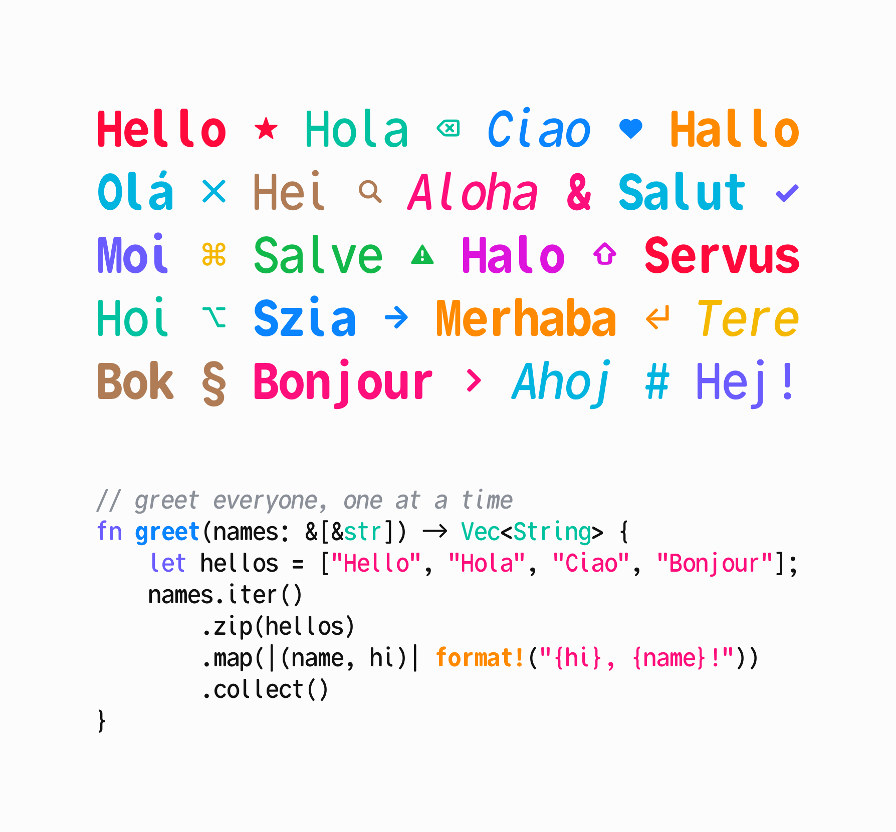

<h1 align="center">allomono</h1>

A friendly monospace font, made from <a href="https://allo.joshpuckett.me">Allo</a>.

  

## Install

Download the four files in [`fonts/`](fonts), install them, and choose
**allomono** in your terminal or editor.

It is drawn for 13pt on a high-density (Retina) display, and hinted for
ordinary ones.

## What you get

- Regular, Bold, Italic and Bold Italic.
- Arrows when you type them: `->`, `=>` and `<-` with a space either side.
  They never change the width of anything.
- 996 characters, including accented Latin, box drawing and the symbols
  terminal programs print. [See them all.](docs/characters-010b7f7d.png)

## Too much?

These are standard OpenType features, so any terminal or editor that lets you
set font features can switch them.

| To get | Feature |
|---|---|
| `->` as typed | `calt` off |
| A single-story a | `ss01` on |
| An open 4, 6 and 9 | `ss03` on |
| A dotted zero | `cv05` on |

## Thanks

allomono is [Allo](https://allo.joshpuckett.me) by Josh Puckett, fitted to a
grid. It is not part of Allo, and any faults in it are not his. Allo in turn
began from [Inter](https://rsms.me/inter/) by Rasmus Andersson.

## Licence

[SIL Open Font License 1.1](OFL.txt)
